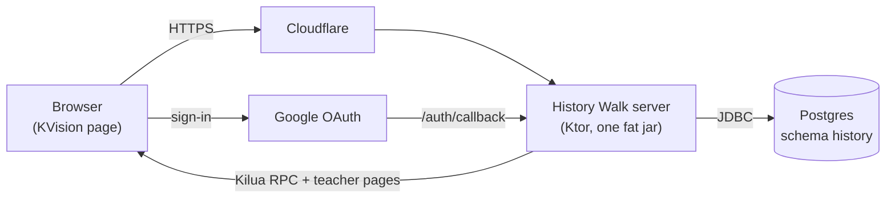

# Administrator guide

This part of the guide is for whoever configures, deploys, and maintains History Walk: setting up Google sign-in,
keeping the teacher list, running the database, shipping releases, and fixing what breaks.

## What you're running

History Walk is one application, deployed once per walk. Each deployment serves one slide deck, chosen by an
environment variable, and has its own database, teacher list, and Google sign-in settings.

| Deployment | `SLIDES_VARIABLE_NAME` | Serves |
|---|---|---|
| Jermain | `jermain` (the default) | The Underground Railroad scenario of Jarm Logue |
| Moses | `moses` | The Moses scenario |

The parts:

- **The server**, a Kotlin [Ktor](https://ktor.io) application, packaged with everything it needs as one jar,
  `build/libs/history-walk.jar`. It serves the page, the API the page calls, and the teacher pages, and it holds the
  slide decks: content is compiled into the jar.
- **The page**, a Kotlin/JS single-page app ([KVision](https://kvision.io)) bundled into the same jar. It talks to
  the server over [Kilua RPC](https://github.com/rjaros/kilua-rpc).
- **Postgres**, holding users, their moves and reasons, and the app's one setting. The server migrates the schema
  itself, with [Flyway](https://flywaydb.org), each time it starts.
- **Google OAuth** for sign-in. Only accounts in the school's domain are admitted; the role comes from the address.
- **Cloudflare** in front of the Heroku deployments. The server's headers keep it from caching anything per-user,
  and make every release reach browsers at their next page load (see [Releases and updates](releases.md)).

The server needs **Java 25**. It runs the same way on Heroku, on Railway, and in Docker.

## Common tasks

| To | See |
|---|---|
| Set or look up an environment variable | [Configuration](configuration.md) |
| Fix a sign-in error, or set up a new deployment's Google client | [Google sign-in](google-sign-in.md) |
| Add or remove a teacher | [Teachers and students](access.md) |
| Deploy, or move to another host | [Deployment](deployment.md) |
| Back up, restore, or reset a database | [Database](database.md) |
| Ship a new version | [Releases and updates](releases.md) |
| Change the story | [Slide decks](slide-decks.md) |
| Diagnose a problem | [Monitoring and troubleshooting](troubleshooting.md) |
| Work on the code | [Development](development.md) |

## Privacy

The app stores, for each person who signs in: their Google name, address, and profile picture link; the slide they
are on; and every move they made, with its reason and time. A student sees only their own walk; the class pages are
for teachers only and are never cached. Treat database backups as student records.
